# CloudSync: Visual Guide

Every diagram here is [Mermaid](https://mermaid.js.org). GitHub renders them in place. Locally, use the VS Code
"Markdown Preview Mermaid Support" extension, or paste a block into <https://mermaid.live>.

| # | Diagram | Answers |
|---|---|---|
| 1 | System architecture | What runs where, and how does data flow? |
| 2 | Solution layout | Which project depends on which? |
| 3 | Class diagram | What are the types and patterns? |
| 4 | Database schema | What is stored in the catalog? |
| 5 | Upload sequence | What happens on `POST /api/files`? |
| 6 | Upload pipeline | How is memory kept bounded? |
| 7 | Dedup decision | How is a chunk written exactly once? |
| 8 | Crash consistency | What if the server dies mid-write? |
| 9 | Download sequence | How is a file rebuilt and verified? |
| 10 | Delta sync | How does an edit upload only changed chunks? |
| 11 | gRPC storage worker | How does the gateway talk to a worker? |
| 12 | Chunking: fixed vs CDC | Why content-defined chunking survives inserts |
| 13 | On-disk layout | Where do the bytes live? |
| 14 | Concept map | How do all the ideas fit together? |
| 15 | Authorization | Who may do what to which file or folder? |
| 16 | Trash, versions and GC | When do bytes actually get freed? |

---

## 1. System architecture

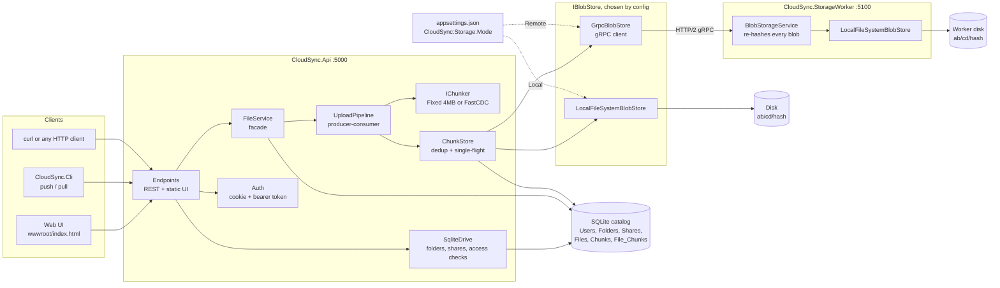

---

## 2. Solution layout

Arrows point from a project to what it depends on. `Core` depends on nothing concrete.

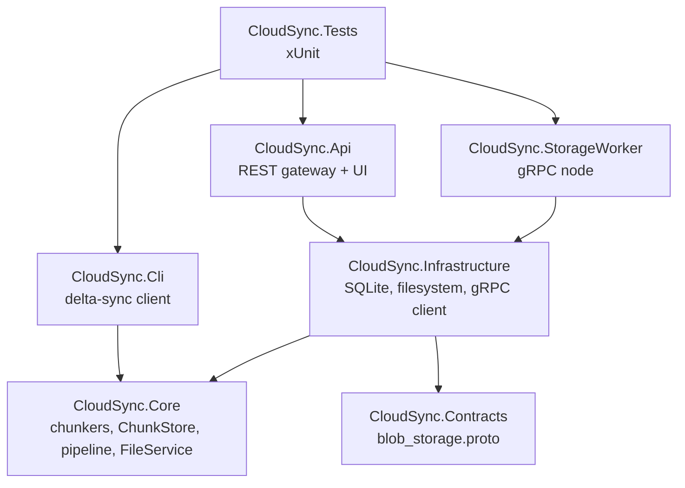

---

## 3. Class diagram

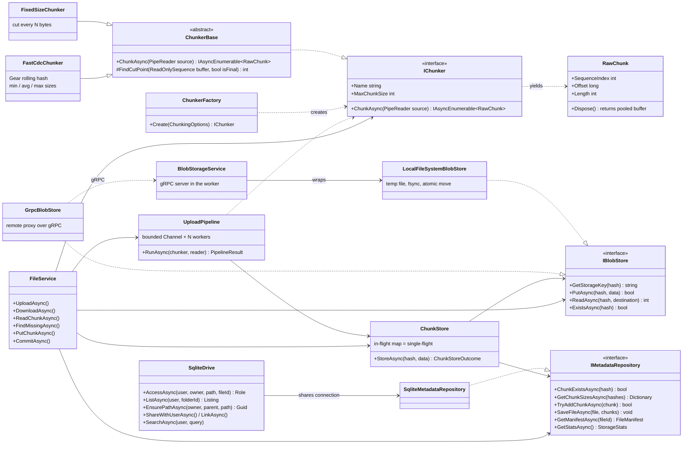

Patterns: **Strategy** (`IChunker`, `IBlobStore`), **Template Method** (`ChunkerBase`), **Repository**
(`IMetadataRepository`), **Remote Proxy** (`GrpcBlobStore`), **Facade** (`FileService`), **Factory**
(`ChunkerFactory`), **Producer-Consumer** (`UploadPipeline`), **Single-flight** (`ChunkStore`), **Object Pool**
(`ArrayPool` behind `RawChunk`).

---

## 4. Database schema

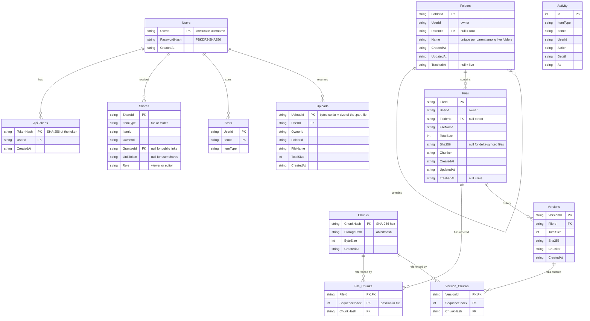

Folders form a tree through `ParentId`; deleting a folder cascades to its subfolders and files. A file with
`FolderId` NULL sits at its owner's root ("My Drive"). `File_Chunks` is the junction table. Position lives there because the same chunk can sit at different positions in
different files. The foreign key on `ChunkHash` means a manifest can never reference a chunk that was not stored.

---

## 5. Upload sequence (`POST /api/files`)

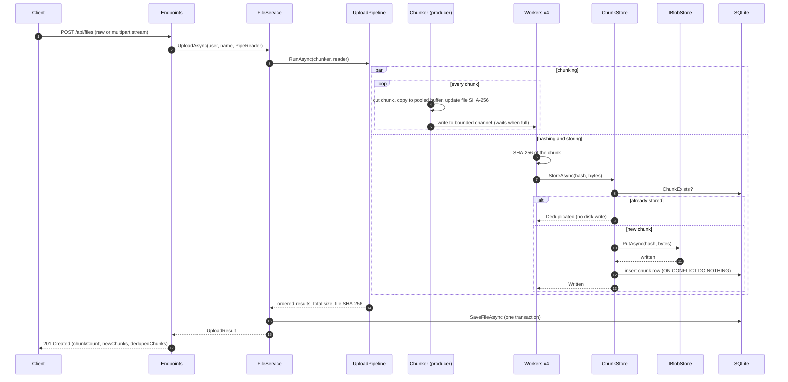

---

## 6. Upload pipeline and backpressure

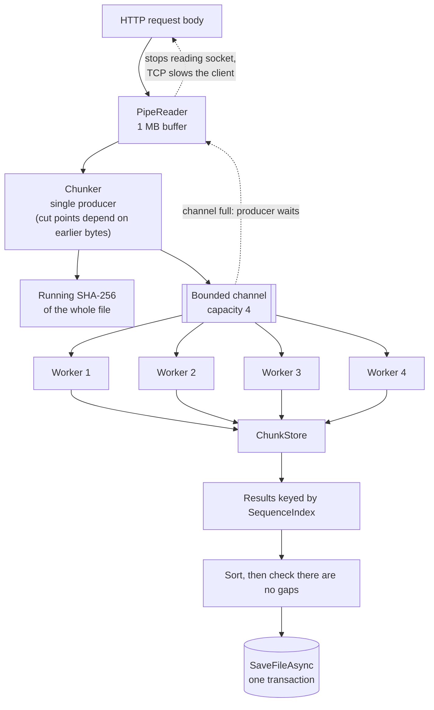

Peak memory = (channel 4 + workers 4 + 1 in the chunker) x 4 MB, about 36 MB per upload, whatever the file size.

---

## 7. Dedup decision (`ChunkStore.StoreAsync`)

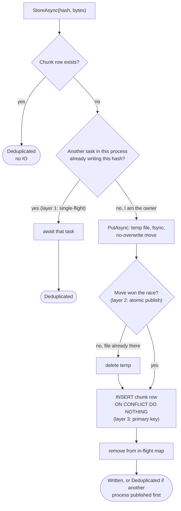

---

## 8. Crash consistency: what if the server dies here?

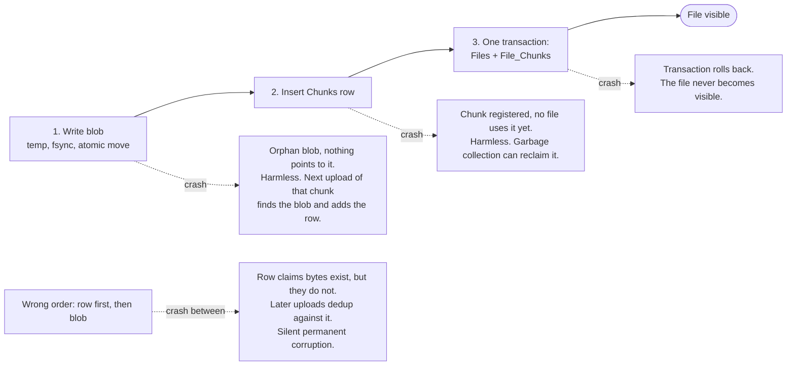

Rule: write the thing being pointed to before the thing that points to it.

---

## 9. Download sequence (`GET /api/files/:id`)

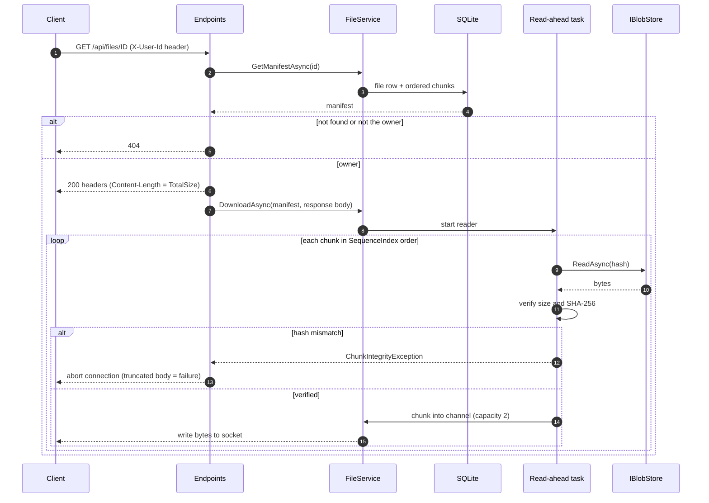

Reading chunk N+1 overlaps with sending chunk N. Headers are already sent when a bad chunk is found, so the only
honest signal left is to cut the connection.

---

## 10. Delta sync

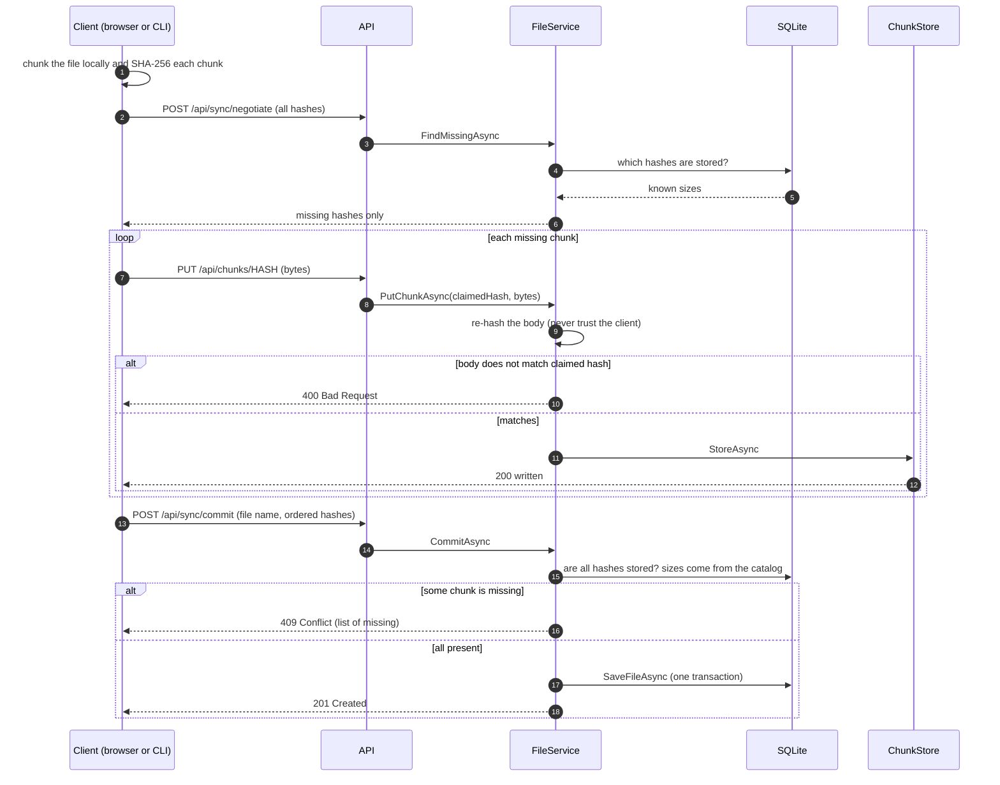

Only the changed chunks cross the network. Dedup works only when client and server chunk the same way.

---

## 11. gRPC storage worker

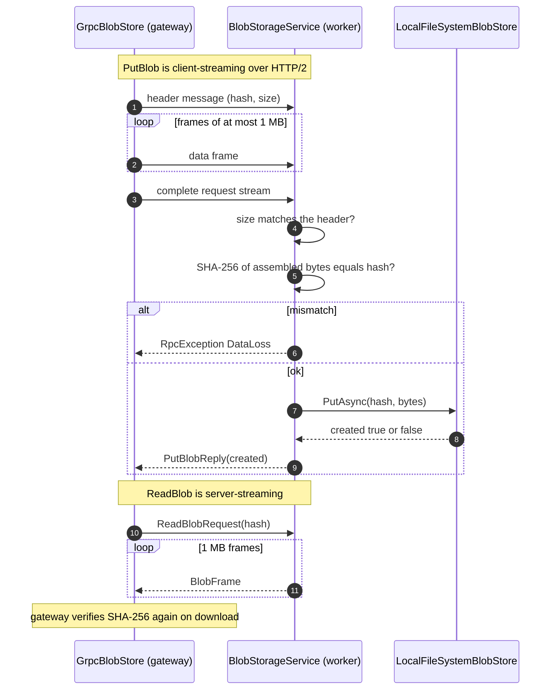

The dedup check happens in the gateway before this call, so duplicate bytes never cross the network.

---

## 12. Chunking: fixed vs content-defined after a 1-byte insert

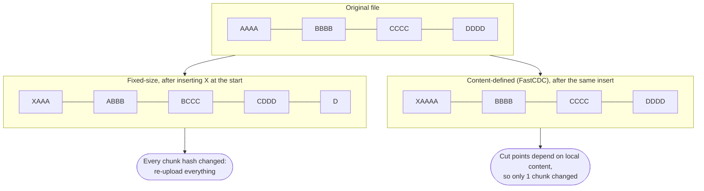

FastCDC cuts where a rolling Gear hash of the last ~64 bytes has its top bits equal to zero, with a minimum size, a
maximum size, and a stricter mask before the average size (normalized chunking).

---

## 13. On-disk layout

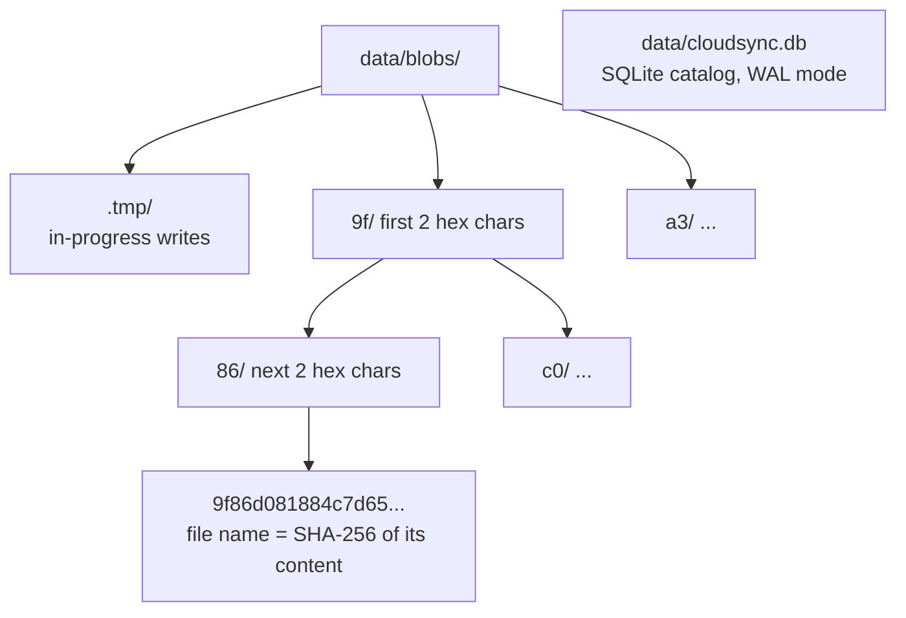

Two prefix levels give 65,536 directories, so no single directory ever holds millions of files.

---

## 14. Concept map

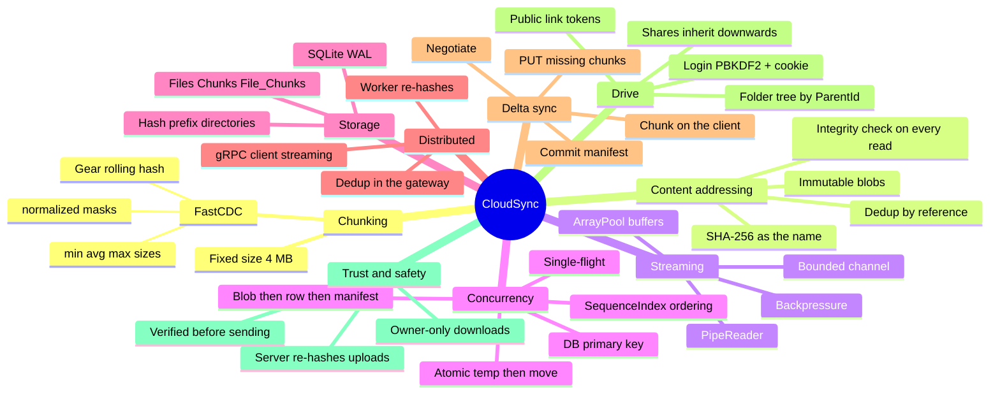

---

## 15. Authorization

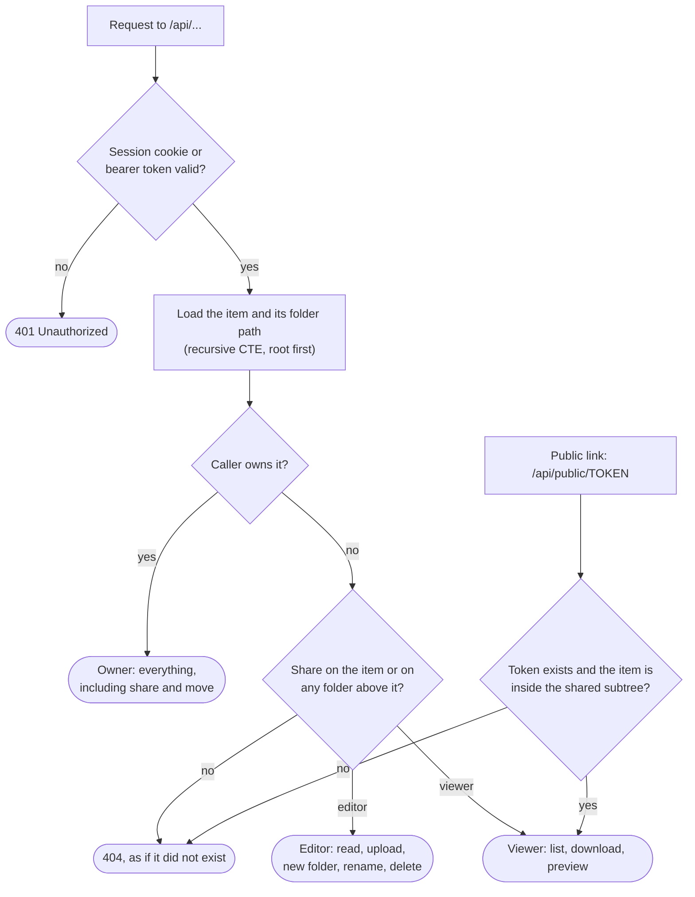

Every file, folder, manifest and chunk endpoint goes through the same check (`SqliteDrive.AccessAsync`), so a
new endpoint cannot accidentally skip it by re-implementing the rules.

---

## 16. Trash, versions and GC

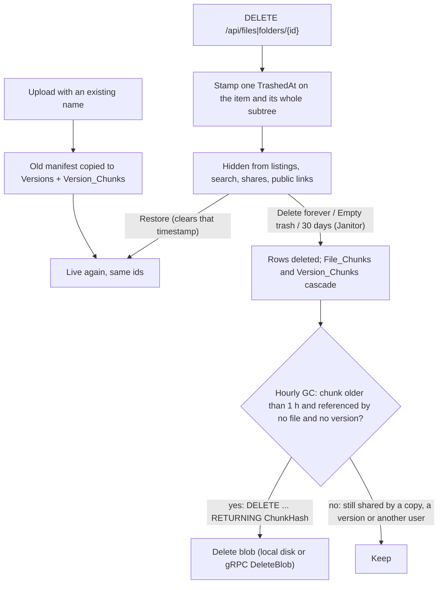

Copies and versions only add rows that point at existing chunks, so a chunk is freed only when the last file or
version that references it is gone. The 1-hour grace keeps chunks of an upload still in flight; if an upload dedups
against a chunk GC deletes at the same moment, the `File_Chunks` foreign key makes that commit fail instead of
saving a manifest with a missing chunk.
